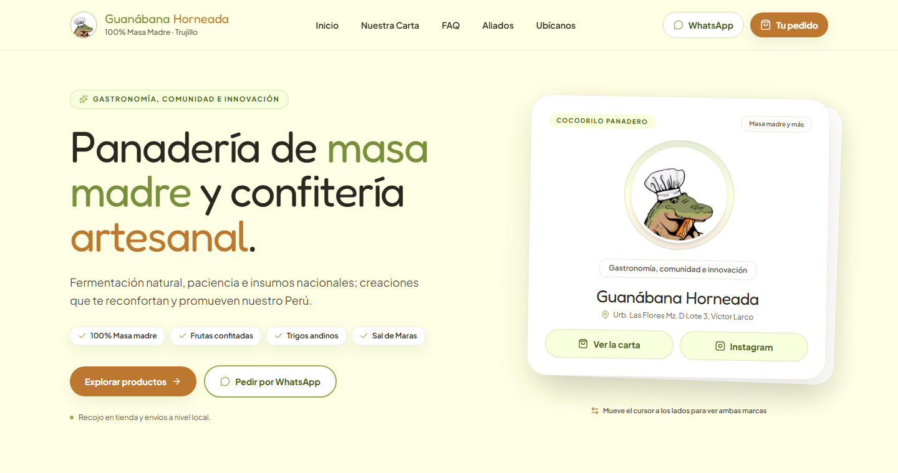
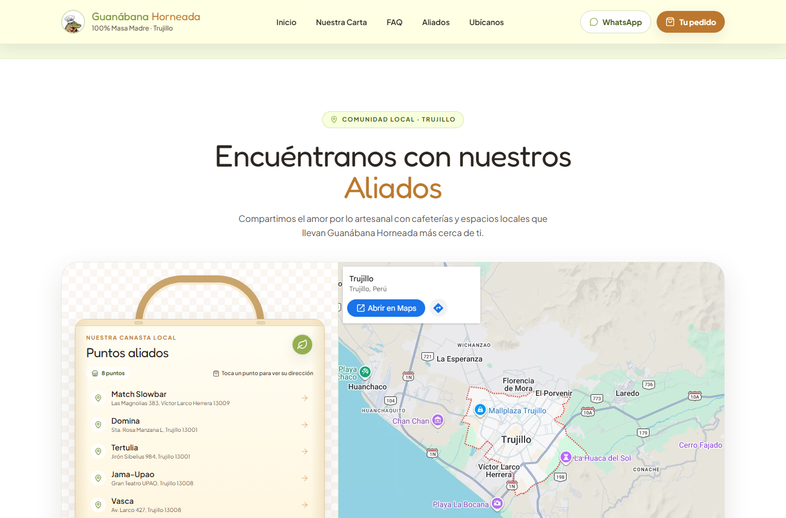
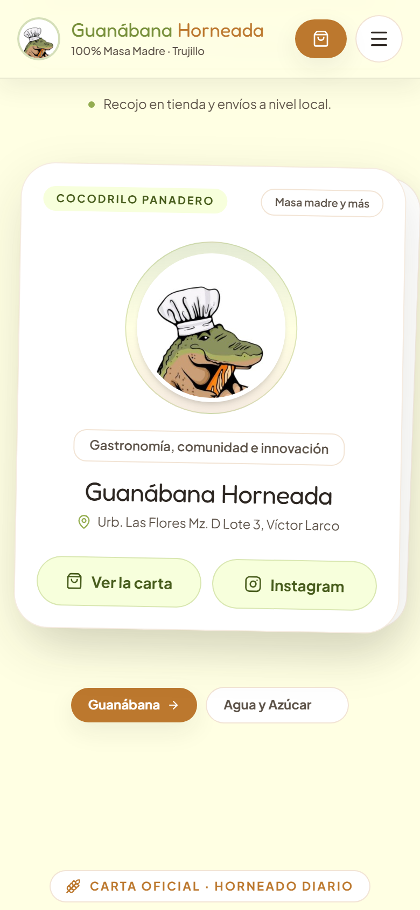

<div align="center">



# 🐊🥖 Guanábana Horneada — Landing

**Landing oficial de la panadería artesanal de masa madre en Víctor Larco, Trujillo.**

Una experiencia cálida para mostrar la carta, contar la historia del obrador, ubicar el taller y llevar el pedido a WhatsApp sin fricción.

[🌐 Ver demo en GitHub Pages](https://kodeguis.github.io/Landing-Guanabana/) ·
[🍞 Ver la carta](#la-carta) ·
[🚀 Cómo usarla](#cómo-usarla)

<br />


</div>

## ✨ Qué es

Esta landing presenta a **Guanábana Horneada**, una panadería y confitería artesanal de Trujillo. No es un e-commerce con pasarela de pago: es una vitrina digital pensada para que el cliente conozca el producto y **cierre el pedido por WhatsApp**.

- **Hero animado** con la mascota cocodrilo y las marcas Guanábana Horneada / Agua y Azúcar.
- **Carta visual** con fotos, precios, badges e ingredientes.
- **Carrito** con resumen y mensaje listo para WhatsApp.
- **Secciones de marca**: historia, aliados, mapa de ubicación, preguntas frecuentes y agradecimiento.
- **Diseño responsive** con una intro animada y detalles de movimiento.
- **Catálogo en Supabase** (opcional): si no hay credenciales, funciona con el catálogo demo local.

> El **ERP, el backend del bot y la gestión de pedidos/stock** viven en un repositorio privado separado. Esta landing es la cara pública.

## 📸 Vista previa

<div align="center">
  
  <br /><br />
  
  <br /><br />
  
</div>

También puedes abrir la **[demo publicada en GitHub Pages](https://kodeguis.github.io/Landing-Guanabana/)**.

## 🧭 Cómo usarla

### Navegar la landing

1. Abre la demo o ejecuta el proyecto localmente.
2. Recorre el hero, la carta, los aliados y el mapa desde el menú superior.
3. En la carta, pulsa **Agregar al pedido** para armar el carrito.
4. Abre el carrito, completa tus datos y pulsa **Enviar pedido a WhatsApp**.
5. Se abrirá WhatsApp con el resumen del pedido listo para enviar al número oficial.

### Ejecutarla localmente

Requisitos: **Node.js 20.19+** y npm.

```bash
npm install
npm run dev
```

Se abre en `http://localhost:5173`.

### Construir y previsualizar producción

```bash
npm run build
npm run preview
```

### Conectar Supabase (opcional)

Sin variables de entorno se usa el catálogo demo local. Para leer el catálogo real:

1. Copia `.env.example` a `.env`.
2. Completa:
   ```env
   VITE_SUPABASE_URL=https://<proyecto>.supabase.co
   VITE_SUPABASE_ANON_KEY=<publishable-key>
   ```
3. El catálogo se carga desde la tabla `products` de Supabase.
4. Si el backend de pedidos está disponible, agrega:
   ```env
   VITE_API_URL=https://bot.tudominio.com
   ```

## 🚀 Deploy

### GitHub Pages (incluido)

El workflow [`.github/workflows/pages.yml`](.github/workflows/pages.yml) compila y publica la landing en **GitHub Pages** en cada push a `main`.

- URL: `https://kodeguis.github.io/Landing-Guanabana/`
- Build base: `VITE_BASE_PATH=/Landing-Guanabana/`

### Vercel

1. Importa el repo en [vercel.com/new](https://vercel.com/new).
2. Build Command: `npm run build` · Output Directory: `dist`.
3. Variables: `VITE_SUPABASE_URL`, `VITE_SUPABASE_ANON_KEY` y, si aplica, `VITE_API_URL`.
4. Deploy.

> `vercel.json` ya incluye la reescritura SPA para `/admin` (el admin real vive en el repo privado del ERP).

## 🧱 Stack y estructura

- **React 19** + **TypeScript** + **Vite 8**
- **Tailwind CSS 4** (tokens de diseño en `src/index.css`)
- **Framer Motion** para la intro y transiciones
- **Lucide** para iconografía
- **Supabase** para catálogo en vivo (opcional)
- **GitHub Actions + Pages** para la vista previa

```text
src/
  components/   Hero, carta, carrito, aliados, mapa, FAQ y footer
  context/      Catálogo y carrito
  data/         Textos, productos demo y configuración del negocio
  lib/          Cliente Supabase y utilidades
public/         Mascota, fotos y assets de marca
docs/           Capturas para el README
```

## 🐊 Créditos

Diseño y desarrollo para **Guanábana Horneada** · Víctor Larco Herrera, Trujillo, Perú.

Hecho con masa madre, cariño y un cocodrilo panadero.

---

<div align="center">
  <sub>Landing pública. El sistema de pedidos, stock y bot de WhatsApp se gestiona en un repositorio privado.</sub>
</div>
